<p align="center">
  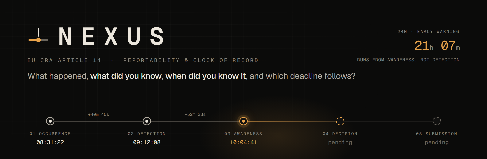
</p>

<p align="center">
  <b>Know the moment the reporting clock started, and be able to prove it.</b><br />
  Evidence-backed reportability decisions and a tamper-evident Clock of Record for
  <a href="https://eur-lex.europa.eu/eli/reg/2024/2847/oj">EU Cyber Resilience Act</a> Article 14.
</p>

<p align="center">
  
  
  
  
  
  
</p>

<p align="center">
  <a href="#the-problem">The problem</a> ·
  <a href="#the-clock-of-record">Clock of Record</a> ·
  <a href="#how-a-determination-is-made">Determination</a> ·
  <a href="#evidence-and-the-ledger">Ledger</a> ·
  <a href="#security">Security</a> ·
  <a href="#run-it">Run it</a> ·
  <a href="docs/architecture.md">Docs</a>
</p>

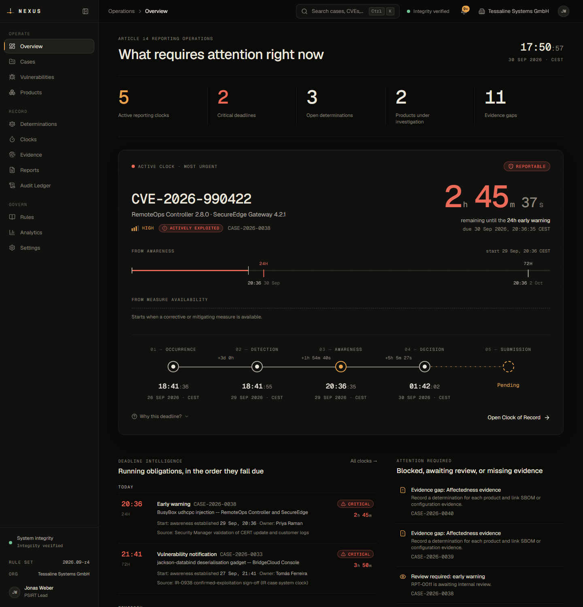

**NEXUS** is decision-support software for manufacturers handling vulnerability reporting under
**Article 14 of the EU Cyber Resilience Act** (Regulation (EU) 2024/2847), which applies from
**11 September 2026**. It answers four questions and keeps the answers on a record that cannot be
quietly rewritten:

> *What happened? What did we know? When did we know it? And which deadline follows from that?*

- **Reportability, product by product.** It separates *contains the vulnerable component* from *is
  affected*, walks a nine-question affectedness procedure that never treats "unknown" as "safe",
  evaluates the Article 14 rules (including the two-date transitional rule), and records the
  decision, **including a decision not to report**, with its rationale, evidence and rule-set version.
- **A defensible Clock of Record.** **Occurrence, detection, awareness, decision and submission**
  stay five separate, immutable, hash-sealed timestamps. The 24-hour, 72-hour and 14-day deadlines
  are derived from the right one, and a wrong timestamp is corrected with a new event, never by
  editing history.
- **A ledger that checks itself.** Every change lands in an append-only, SHA-256 hash-chained audit
  ledger. Your browser can verify it independently of the server.

> [!IMPORTANT]
> NEXUS provides technical and operational decision support. It does not constitute legal advice
> or a legal determination of regulatory compliance.

### Why "NEXUS"

In law and compliance, a *nexus* is the connection that makes an obligation attach. Article 14 is
a nexus question twice over. Does this vulnerability connect to *this* product closely enough to
make it reportable? And to which moment does the 24-hour clock connect: the alert, the analyst's
first look, or the point the organisation actually knew? NEXUS exists to make both connections
explicit, evidenced and reviewable.

---

## The problem

Article 14(2) gives a manufacturer **24 hours** from becoming aware of an actively exploited
vulnerability to send an early warning, **72 hours** to send a vulnerability notification, and
**14 days after a corrective or mitigating measure is available** to send a final report.

Every one of those deadlines is measured from a moment, and most organisations cannot say which
moment. The alert fired at 08:31. The analyst saw it at 09:12. PSIRT confirmed it at 10:04.
Somebody decided at 11:18. Which one is "became aware"? If the answer is "whichever the incident
ticket shows", then *the ticket's timezone setting* decides whether you were compliant.

Two further problems make it harder:

- **"Contains" is not "affected".** A scanner that finds `openssl 3.0.9` in an SBOM has found a
  component, not an affected product. Whether the vulnerable code is compiled in, reachable, and
  controllable by an attacker is a product-specific question. Tools that answer it with a scanner
  hit either over-report or, worse, record nothing and quietly decide not to.
- **Not reporting leaves no trace.** A decision to report produces a submission. A decision not to
  report usually produces nothing, even though it is the higher-risk decision to defend later.

### Rules NEXUS will not break

| | |
| --- | --- |
| **Unknown is never safe** | An UNKNOWN answer produces UNDER INVESTIGATION with an owner and a due time, and any running clock keeps running. |
| **Detection is not awareness** | A scanner hit opens an investigation. Only an awareness criterion met on evidence starts a clock. |
| **Only an approved decision stops a clock** | A rule evaluation that *suggests* "not reportable" changes nothing. A recorded decision not to report takes effect only when Compliance or Legal approve its decision record, and lapses if new awareness is recorded after it. |
| **History is never edited** | The database refuses UPDATE and DELETE on every history table. Corrections are new events that name what they supersede. |
| **Not reporting leaves the same record as reporting** | A decision not to report needs determinations, an exploitation assessment, evidence and a rationale, and goes to compliance or legal review. |
| **Nothing leaves the building** | Submission is simulated and labelled as such. There is no outbound network call anywhere in the product. |

---

## A two-minute tour

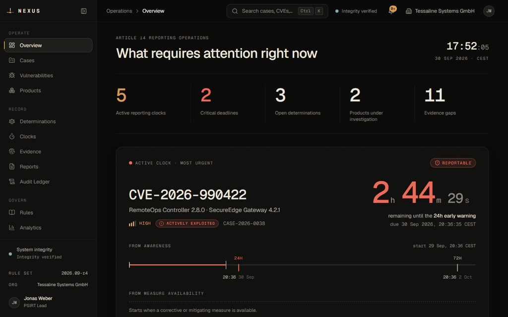

---

## The Clock of Record

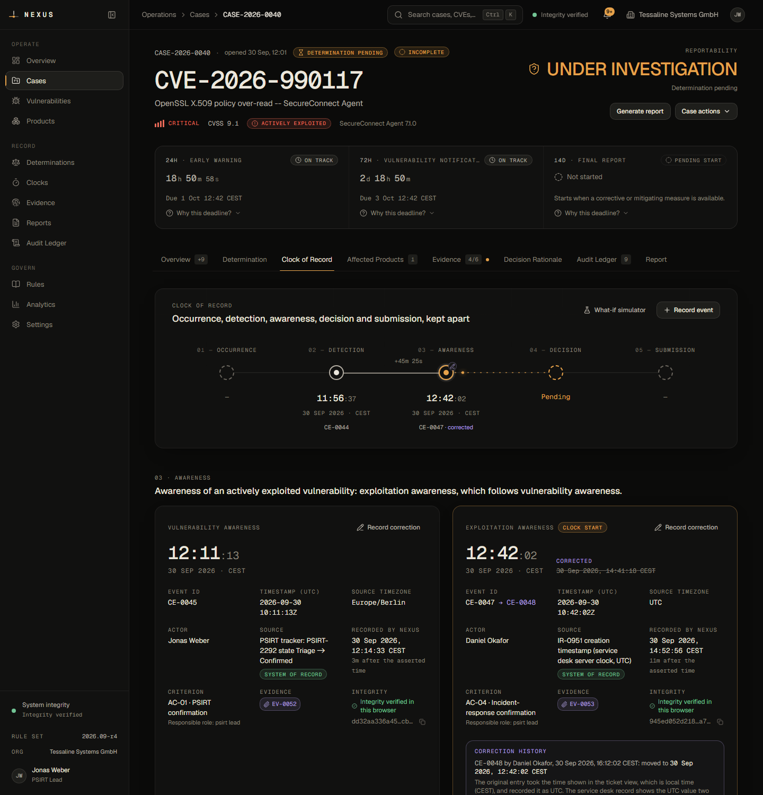

```text
01 OCCURRENCE    first observed exploitation              08:31:22   external document
      ↓ +40m 46s
02 DETECTION     first signal the organisation received   09:12:08   system of record
      ↓ +52m 33s
03 AWARENESS     an awareness criterion was met           10:04:41   system of record   ← clock start
      ↓ +1h 13m 22s
04 DECISION      reportability decision recorded          11:18:03   NEXUS server
      ↓
05 SUBMISSION    early warning submitted                  pending
```

- **Awareness is two events.** *Vulnerability awareness* and *exploitation awareness* are each
  recorded against one of the organisation's configured criteria (PSIRT confirmation, validated
  exploitation evidence, incident-response confirmation and so on), with the evidence the criterion
  requires. The reporting clock starts at **exploitation awareness**: awareness of an *actively
  exploited* vulnerability, which includes awareness of the vulnerability. A vulnerability-awareness
  record dated later cannot push the clock back; the contradiction is raised as a blocking error.
- **Immutable.** Clock events cannot be edited or deleted; the database refuses. A wrong timestamp
  is corrected by a **correction event** that names the event it supersedes, carries a reason and
  evidence, and leaves the original visibly on the record.
- **Server-witnessed moments cannot be corrected.** DECISION and SUBMISSION are stamped by
  NEXUS's own clock when they happen.
- **Future timestamps are rejected** (beyond two minutes of skew), and an entry recorded more than a
  day after the time it asserts is flagged as retrospective.
- **Integrity verified in the browser.** The Clock of Record recomputes each event's SHA-256 from
  its canonical JSON with Web Crypto and compares it with the stored hash.

### Deadlines

| Deadline | Rule | Starts at | Duration |
| --- | --- | --- | --- |
| Early warning | Art. 14(2)(a) | awareness of the actively exploited vulnerability | 24 hours |
| Vulnerability notification | Art. 14(2)(b) | the same | 72 hours |
| Final report | Art. 14(2)(c) | **a corrective or mitigating measure being available** | 14 days |

The final-report clock stays **pending** until the measure-available event is recorded; it is not
measured from awareness. Every deadline has a **Why this deadline?** panel that shows the rule,
the start event, its source and the arithmetic. Deadlines are **derived, never stored**, so a
corrected awareness time moves every downstream deadline while the original stays on the record.

### The transitional rule

Article 14 applies from 11 September 2026 (Art. 71(2)). Whether it applies turns on **two**
awareness dates, not one:

| Vulnerability known | Exploitation known | Article 14 |
| --- | --- | --- |
| before 11 Sep | before 11 Sep | does not apply |
| before 11 Sep | **after** 11 Sep | **applies**, and the clock starts at exploitation awareness |
| after | after | applies |

The regulation states a date, not an instant. NEXUS's rule set reads the boundary as
**00:00 CEST (2026-09-10T22:00:00Z)**, says so on the Rules page, and flags any trigger within 24
hours of it for counsel review. The demo covers both halves of the table. A mosquitto case where
both dates precede application is recorded as *not reportable*, with the decision itself dated
after 11 Sep. A jackson-databind case, known on 3 Sep but exploited after, is reportable.

---

## How a determination is made

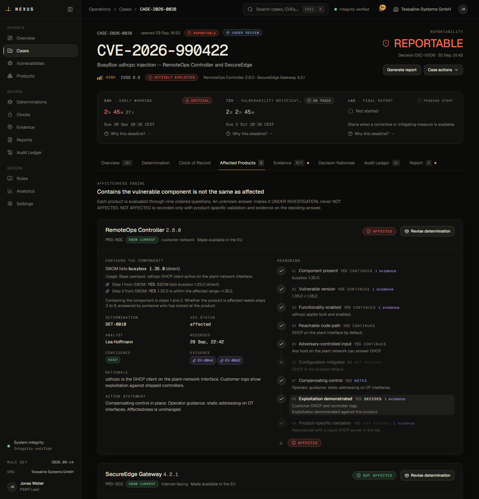

Nine ordered questions, per product:

| # | Question | Decides |
| --- | --- | --- |
| 1 | Component present? | NO: `component_not_present` |
| 2 | Vulnerable version? | NO: `vulnerable_code_not_present` |
| 3 | Vulnerable functionality compiled in and enabled? | NO: `vulnerable_code_not_present` |
| 4 | Reachable in the execution path? | NO: `vulnerable_code_not_in_execute_path` |
| 5 | Adversary-controlled input can reach it? | NO: `vulnerable_code_cannot_be_controlled_by_adversary` |
| 6 | Shipped configuration mitigates? | YES: `inline_mitigations_already_exist` |
| 7 | Compensating control in place? | never decides; becomes the VEX action statement |
| 8 | Exploitation demonstrated against this product? | YES: AFFECTED |
| 9 | Product-specific validation completed? | required before any NOT AFFECTED |

- Steps 1 and 2 are **suggested from the SBOM** and confirmed by the analyst. Steps 3 to 9 need
  someone who has looked at the product. A stale or missing SBOM never suggests *absent*.
- NOT AFFECTED needs step 9 answered YES **and** evidence linked to the deciding answer. Otherwise
  the result is UNDER INVESTIGATION, which requires a next action, an owner and a due time.
- **The server computes the result from the answers.** A result sent by the client is ignored.
- Output is a **VEX-style** document shaped after OpenVEX v0.2.0 (not schema-validated or signed).

### Decisions, including the decision not to report

The rule evaluation produces a *suggested* outcome and a transparent trace. The analyst records the
**decision**, and may diverge from the suggestion only by recording why. A **decision not to
report** requires a determination for every product, an exploitation assessment, an awareness
event, a reason, a rationale and supporting evidence. It automatically generates a **decision
record** that goes to compliance or legal review, and the decision is **not in force until that
record is approved**: until then every clock keeps running and the case cannot be closed. If
exploitation is confirmed after a "no active exploitation" decision, the decision lapses and the
clock runs. Separation of duties is enforced: nobody approves a report they generated or a decision
they recorded, and only the roles in a report kind's approval policy can approve or return it.

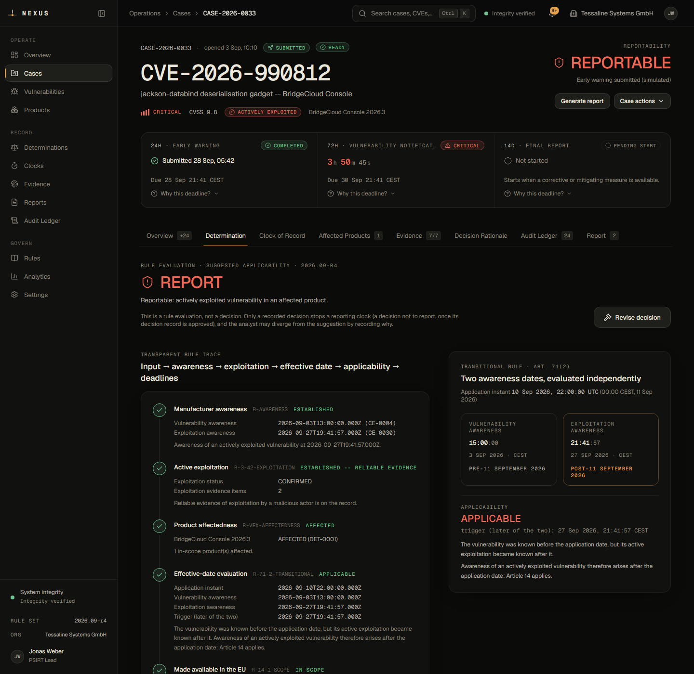

---

## Evidence and the ledger

- **Evidence completeness** is a checklist of what the case requires *in its current state*,
  shown as "5 of 6 applicable items", never as an invented percentage.
- Each evidence file is **sniffed** (PDF, PNG, JPEG or UTF-8 text only; a file whose content does not
  match its declared type is refused), **hashed on the server**, stored content-addressed outside
  the web root, and served only through an authorised download with a sandboxing CSP.
- **Restricted evidence** stays on the register (id, type and hash) for everyone, but its title,
  source, description and file are readable only by PSIRT Lead, Security Manager, Compliance and
  Legal, in every endpoint that returns it.
- **What evidence supports this decision?** One click filters the register to the evidence cited by
  the decision, its determinations and the awareness events it rests on. The evidence chain runs
  Evidence → Awareness event → Determination → Decision → Report.
- The **audit ledger** chains every change with SHA-256. **Verify ledger** recomputes the chain on
  the server; **Verify in this browser** recomputes it with Web Crypto from the raw entries; an
  exported **anchor** (the head hash) catches a chain rewritten consistently from the database file.

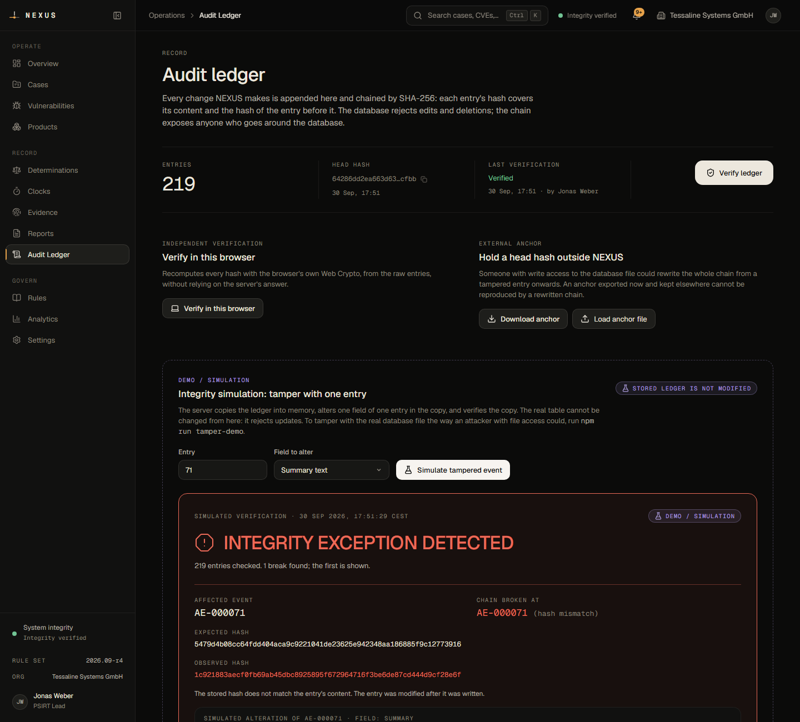

---

## How it fits together

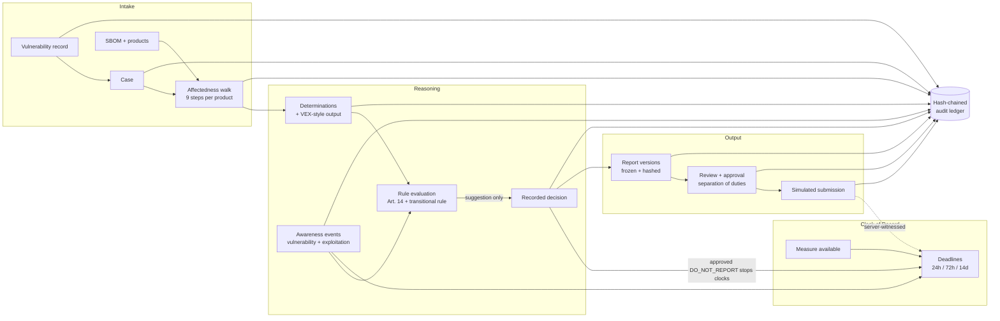

```text
                    Browser (React 19, Vite)                          Node 24 (no build step)
 ┌──────────────────────────────────────────────┐        ┌───────────────────────────────────────────────┐
 │  Shell · Overview · Cases · Case detail tabs │  JSON  │  Hono API                                     │
 │  Clock of Record · Ledger · Reports · …      │◄──────►│  requestId → headers → rate limit → origin    │
 │                                              │  CSRF  │  → session → CSRF → route → structured errors │
 │  lib/engine  (same code as the server)       │ cookie │                                               │
 │   ├ what-if clock simulator                  │        │  RBAC + object-level authorisation            │
 │   ├ browser ledger verification (WebCrypto)  │        │  zod validation, bidi/control-char stripping  │
 │   └ clock-event integrity check              │        │  lib/engine: analyzeCase() on every read      │
 └──────────────────────────────────────────────┘        │  SQLite (node:sqlite) + append-only triggers  │
                                                         │  evidence object store (content-addressed)    │
                                                         │  hash-chained audit ledger                    │
                                                         └───────────────────────────────────────────────┘
```

- **Records vs derived views.** Clock events, determinations, decisions, report versions, reviews,
  evidence and ledger entries are written once. Case status, the clock, deadlines, completeness,
  health and data-quality findings are computed on every read by `analyzeCase()` and never stored.
- **One engine, three runtimes.** `lib/engine/*` is plain TypeScript with no DOM, no network and no
  wall clock ("now" is always an argument). The API server runs it through Node's native type
  stripping, the browser bundles the same files, and the what-if simulator reuses them to replay a
  case with hypothetical timestamps.

| Idea | Where it lives |
| --- | --- |
| Five timestamps, each with its source, authority (system of record > document > recollection), evidence and SHA-256 | [`lib/engine/clock.ts`](lib/engine/clock.ts) |
| Deadlines derived on every read; corrections propagate without migrations | [`lib/engine/deadlines.ts`](lib/engine/deadlines.ts) |
| The two-date transitional rule with a near-boundary flag | [`lib/engine/transitional.ts`](lib/engine/transitional.ts) |
| The affectedness walk: UNKNOWN never produces NOT AFFECTED | [`lib/engine/affectedness.ts`](lib/engine/affectedness.ts) |
| The rule set as versioned data, cited on every deadline | [`rules/cra-article14.ts`](rules/cra-article14.ts) |
| Append-only enforced twice: SQLite triggers and a hash chain | [`server/db.ts`](server/db.ts), [`lib/engine/ledger.ts`](lib/engine/ledger.ts) |

Deeper reading: [architecture](docs/architecture.md) · [data model](docs/data-model.md) ·
[rule engine](docs/rule-engine.md) · [threat model](docs/threat-model.md).

---

## Security

NEXUS's output is meant to be trusted by people who were not in the room, so it treats itself as
a security-sensitive application. The full model, with residual risks, is in
[docs/threat-model.md](docs/threat-model.md).

| Threat | Control |
| --- | --- |
| Backdating or forward-dating awareness to move a deadline | Future times rejected; server `recordedAt` the client cannot set; retrospective entries flagged; server-witnessed DECISION and SUBMISSION |
| Rewriting history | SQLite triggers abort UPDATE and DELETE on all eleven history tables; corrections are new rows |
| Editing the database file directly | SHA-256 hash chain verified on the server **and** in the browser; exported anchor; `npm run tamper-demo` proves it |
| Privilege escalation and IDOR | Role matrix enforced per route on the server; object-level checks on every case write; separation of duties on approvals |
| Restricted evidence disclosure | Title, source, description and file redacted server-side for roles without `evidence.read_restricted`, in every endpoint |
| Malicious uploads | Content sniffed from the bytes (PDF, PNG, JPEG, UTF-8 text); mismatched types refused; content-addressed store outside the web root; sandboxing CSP on download |
| CSRF and session theft | SameSite=Strict, `__Host-` + Secure in production, Origin check, per-session synchroniser token, only the token's SHA-256 stored, idle and absolute expiry |
| Report tampering after approval | Immutable report versions with a content hash; only the latest version may become READY or SUBMITTED |
| Trojan Source, CSV formulas, Markdown forgery | Bidi and zero-width characters stripped at the boundary and in every exporter; formula cells neutralised; pipes escaped; HTML fully escaped |
| Script injection | CSP `script-src 'self'` with no inline script, `frame-ancestors 'none'`, `nosniff`, COOP/CORP, `no-store` on the API, HSTS in production |
| Brute force | Sign-in limited to 10 per minute; scrypt hashes; identical response for unknown account and wrong password |
| Leaks through errors and logs | Structured errors without stack traces; logs carry method, path, status, duration and user, never bodies, cookies or query strings |

Found something? See [SECURITY.md](SECURITY.md).

---

## Screens

| | |
| --- | --- |
| 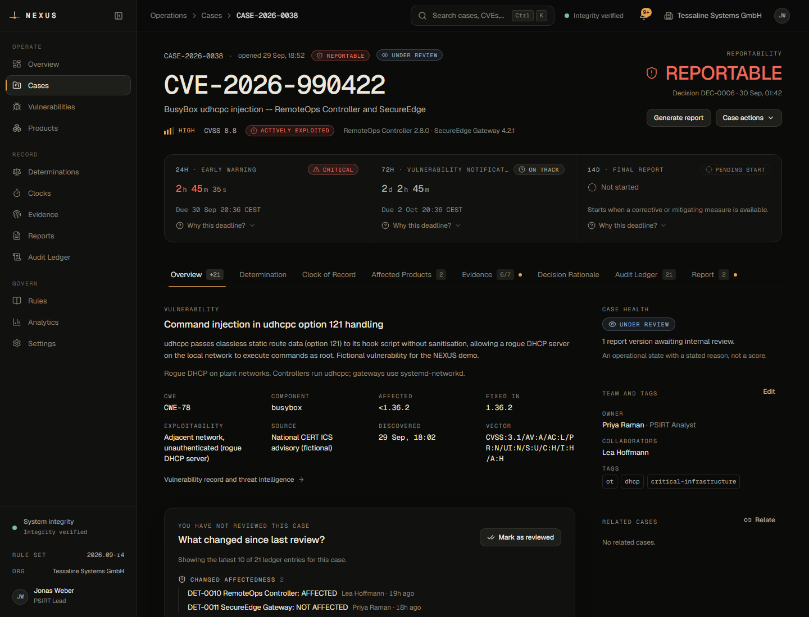 | 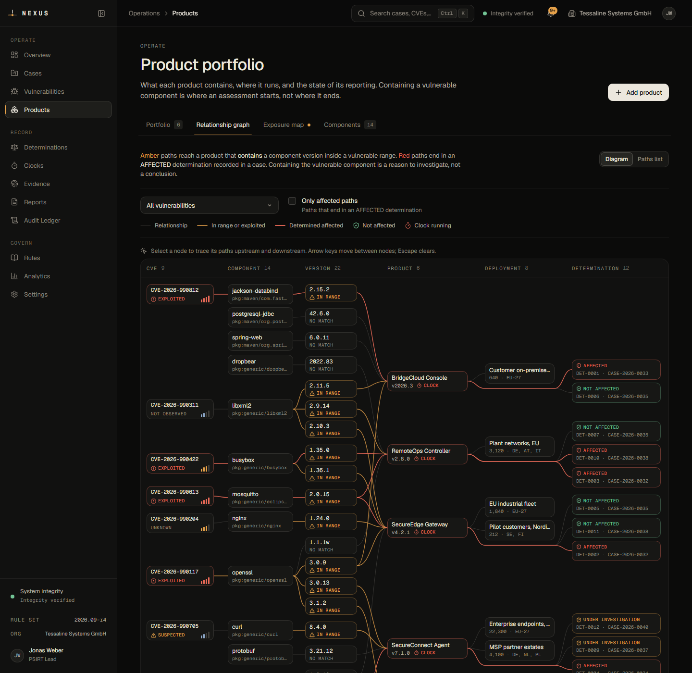 |
| **Case detail.** The state the case exists to produce, with the three deadlines under it. | **Relationship graph.** *In range* (amber) kept apart from *determined affected* (red). |
| 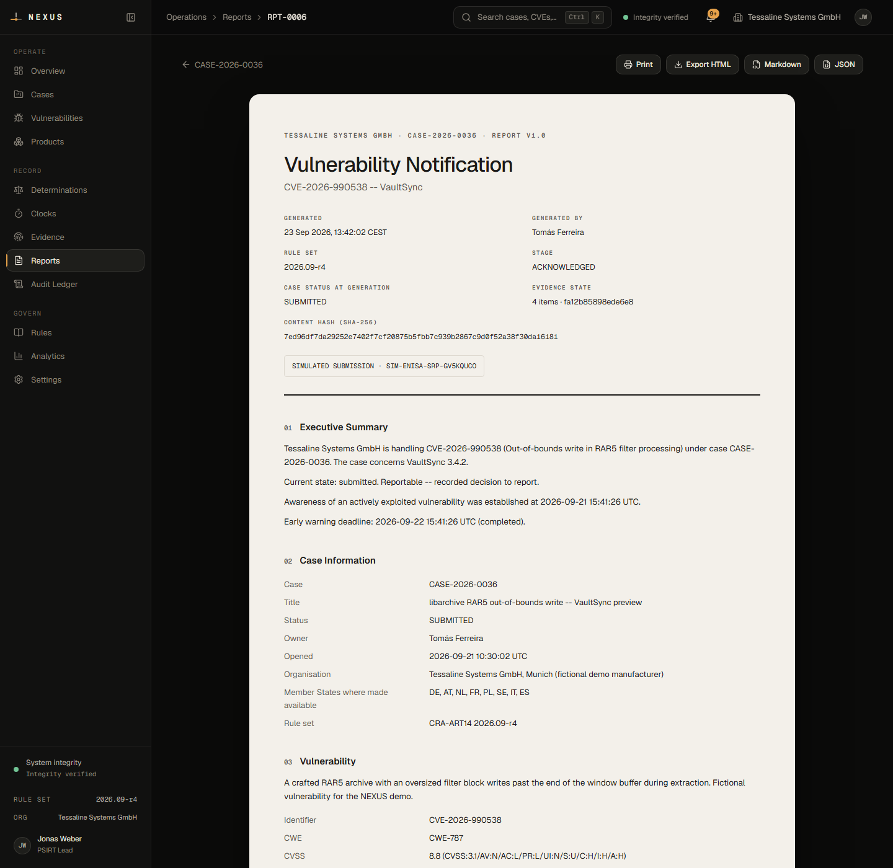 | 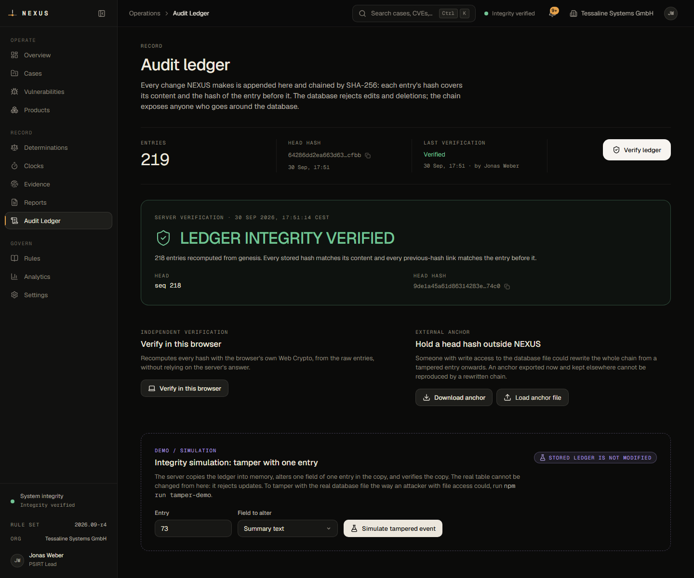 |
| **Report preview.** A frozen, hashed version, with its review workflow beside it. | **Audit ledger.** Server verification, browser verification and the external anchor. |
| 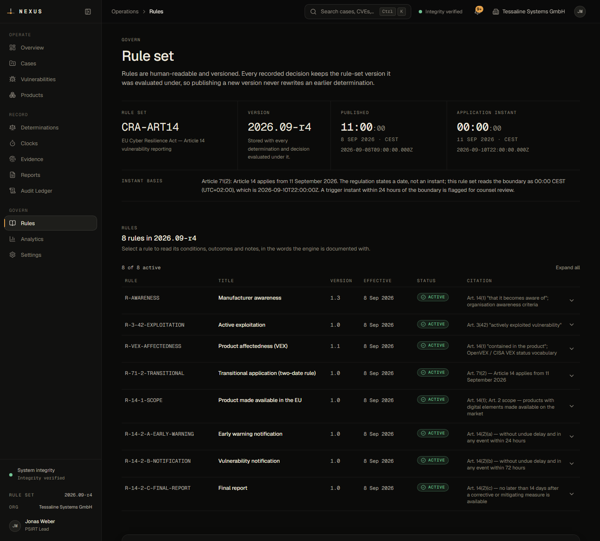 | 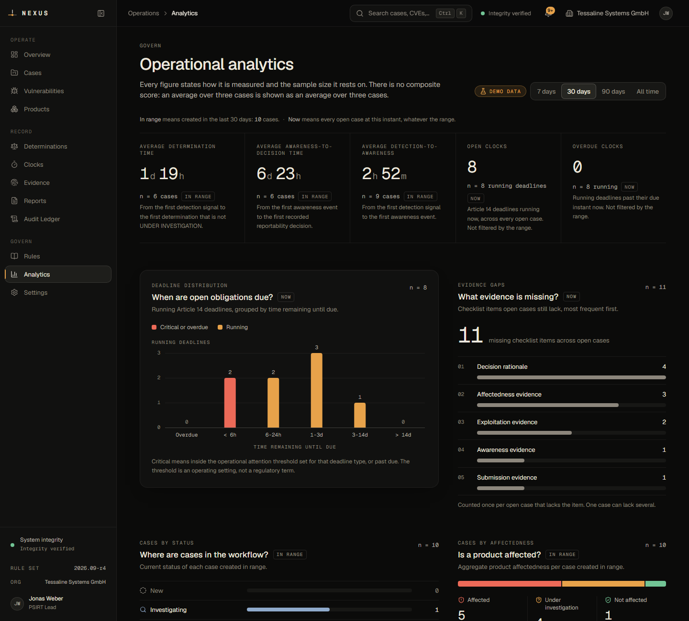 |
| **Rules.** IF/THEN rules, versions, citations, and the self-test behind "operational". | **Analytics.** Deadline outcomes, turnaround and where time is spent. |

<p align="center">
  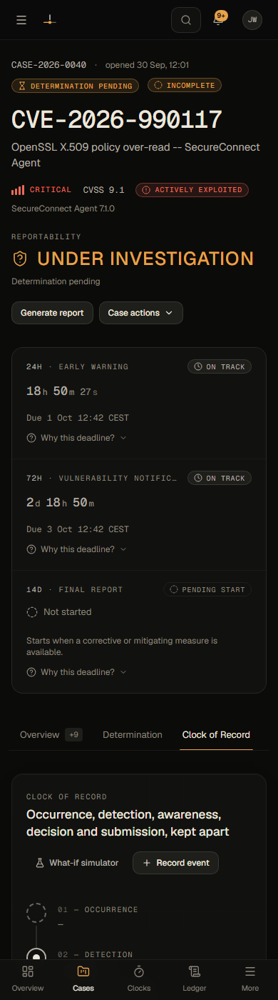<br />
  <sub>On a phone, the Clock of Record becomes a vertical timeline. Every screen works at 375px.</sub>
</p>

---

## Try the demo

The demo organisation, **Tessaline Systems GmbH**, and everything in it is fictional: ten people,
six products, fourteen real open-source component names, and nine **fictional** vulnerabilities in
the unassigned range `CVE-2026-99xxxx`. Ten seeded cases cover every state:

| Case | Shows |
| --- | --- |
| OpenSSL / SecureEdge | awareness just established, no determination yet: the clock runs anyway |
| OpenSSL / SecureConnect | a corrected awareness timestamp (local time entered as UTC), with the original preserved |
| BusyBox udhcpc | the 24h deadline under pressure; one product affected, one not; a report returned for changes |
| jackson-databind | the two-date rule: known 3 Sep, exploited after, so reportable; the 72h deadline critical |
| libarchive | early warning and notification submitted; the final-report clock running from the fix |
| curl | reachability unknown: UNDER INVESTIGATION, LOW confidence, a next action with an owner |
| libxml2 | three products NOT AFFECTED for three different evidenced reasons: not reportable |
| mosquitto | affected and exploited, but both awareness dates precede 11 Sep: not reportable |
| sqlite | the full lifecycle, from detection to closed |
| nginx | a scanner hit only: investigating, no clock |

- **Personas.** Sign in as any of the ten. Jonas Weber (PSIRT Lead) sees the full workflow; Ines
  Kovač (Read Only) sees every write refused by the server.
- **Scenario simulator** (Settings → Demo mode). Six scenarios create fresh cases on demand: active
  exploitation, not affected, uncertain affectedness, 24h pressure, a non-report decision, and
  ledger tampering.
- **What-if clock simulator** (Clocks, or any case's Clock of Record). Move the awareness or measure
  timestamps in a sandbox and watch the deadlines and applicability change. Nothing is recorded.
- **Tamper demo.** The Audit Ledger page alters one entry in an in-memory copy. To do it for real,
  the way an attacker with the database file could, run `npm run tamper-demo`. It drops the
  trigger, rewrites one ledger entry directly in SQLite, restores the trigger and shows verification
  naming the broken entry (`-- --rehash` also recomputes that entry's hash, and the break moves to
  the next link). Restore with `npm run db:reset`.

---

## Run it

Requires **Node 24** or later (for `node:sqlite` and native TypeScript type stripping). No database
server, no Docker, no build step for the API.

```bash
git clone https://github.com/het-P301204/NEXUS.git
```

```bash
cd NEXUS && npm install
```

```bash
npm run dev
```

Open <http://localhost:5173> and pick a persona. The first start seeds the demo database into
`./storage/` with times relative to now, so the clocks are live. Run `npm run db:reset` with the
server stopped to re-seed.

Production build, served by the API server with the full CSP:

```bash
npm run build && npm start
```

Configuration is environment-only; see [.env.example](.env.example). Run with `DEMO_MODE=false`
anywhere real data is stored.

| Script | Does |
| --- | --- |
| `npm run dev` | API on :8787 (watch mode) and the Vite app on :5173 |
| `npm test` | the full vitest suite |
| `npm run verify` | lint, typecheck, tests and the production build |
| `npm run db:reset` | re-seed the demo database |
| `npm run tamper-demo` | tamper with the real database file and watch verification catch it |

## Tests

170 tests across the engine and the API, all runnable offline with `npm test`:

- **Engine.** Deadline arithmetic at the boundaries, attention thresholds, completion on time and
  late, corrections and chained corrections, the transitional rule at and around the boundary, all
  five VEX exits, UNKNOWN never producing NOT AFFECTED, validation and evidence requirements,
  reportability, completeness, every data-quality check, the Clock of Record stages, hash-chain
  tamper, re-hash and deletion detection, anchors, Web Crypto parity, text hygiene, and
  CSV/Markdown/HTML export safety.
- **API** (in-memory SQLite, seeded). Unauthenticated access, CSRF and Origin rejection, security
  headers, sign-in rate limiting, Read Only refusal, object-level refusal, restricted evidence,
  awareness criteria and evidence requirements, duplicate and future-dated events, corrections,
  server-witnessed timestamps, database-level immutability, server-computed determinations,
  non-report validation, divergence, separation of duties, simulated submission, report
  versioning, upload type sniffing, all-or-nothing import, the tamper simulation leaving the
  ledger intact, demo endpoints absent outside demo mode, formula-injection and bidi handling, and
  a final ledger verification after everything else in the suite.
- **Reviews.** Two dedicated suites pin the results of an adversarial security review
  ([`tests/server/security-review.test.ts`](tests/server/security-review.test.ts)) and a
  correctness review ([`tests/correctness-review.test.ts`](tests/correctness-review.test.ts)).
  Every issue either review confirmed was first reproduced as a failing test, then fixed; the
  attacks that were tried and did not work are pinned too.

## Repository

```text
NEXUS/
├── app/              React routes, shell, case-detail tabs
├── components/       UI primitives, clock, reasoning, ledger, reports, portfolio, analytics, settings
├── lib/
│   ├── engine/       the shared rule engine (clock, deadlines, transitional, affectedness,
│   │                 reportability, completeness, quality, ledger, VEX, report, analytics)
│   ├── client/       browser API client, session, formatting, ticking clock
│   ├── rbac.ts       the role and permission matrix
│   └── text.ts       bidi stripping, CSV/Markdown/HTML escaping
├── rules/            the versioned CRA Article 14 rule set, as data
├── server/           Hono API, SQLite schema, auth, security middleware, seeder
├── data/             the fictional demo organisation, cases and scenarios
├── types/            domain and API types
├── tests/            vitest: engine, text, API integration, security review
├── sample-data/      import samples (CSV, JSON)
├── scripts/          dev runner, db reset, tamper demo
└── docs/             architecture, threat model, data model, rule engine, screenshots
```

## Limitations

- **Not legal advice.** The rule set is an engineering encoding of Article 14 for decision support.
  The boundary interpretation, the awareness criteria and the reliable-evidence bar are
  organisational choices that need counsel.
- **Actively exploited vulnerabilities only.** Severe incidents (Art. 14(3)), user notification
  (Art. 14(8)) and the other CRA obligations are out of scope.
- **Submission is simulated.** Nothing is sent to ENISA's single reporting platform or any CSIRT.
- **No live intelligence feed.** Threat intelligence is manual entry.
- **One organisation per instance**, demo personas instead of an identity provider, and an
  in-memory rate limiter that suits one process.
- **A hash chain alone cannot stop a database-file attacker rewriting the whole chain.** The anchor
  export is the mitigation, and it only works if the anchor is kept somewhere else.
- **VEX-style**, not schema-validated or signed OpenVEX.

## Roadmap

- OIDC sign-in and SCIM provisioning in place of demo personas.
- Signed ledger anchors published to an external transparency log.
- CycloneDX and SPDX SBOM ingestion with automatic product-component mapping.
- Article 14(3) severe-incident reporting on the same Clock of Record.
- Schema-validated, signed OpenVEX and CSAF VEX output.

## Sources

- [Regulation (EU) 2024/2847](https://eur-lex.europa.eu/eli/reg/2024/2847/oj) (Cyber Resilience
  Act), Article 14 (reporting obligations), Article 3 (definitions) and Article 71(2)
  (application dates).
- [OpenVEX specification](https://github.com/openvex/spec) for the status and justification
  vocabulary.

## Disclaimer

NEXUS provides technical and operational decision support. It does not constitute legal advice or
a legal determination of regulatory compliance. All organisations, people, products,
vulnerabilities and advisories in the demo data are fictional.

## License

[Apache-2.0](LICENSE) © 2026 Het Patel
